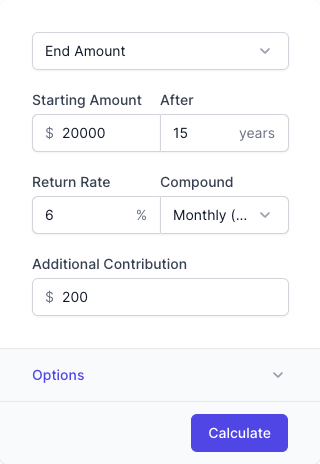
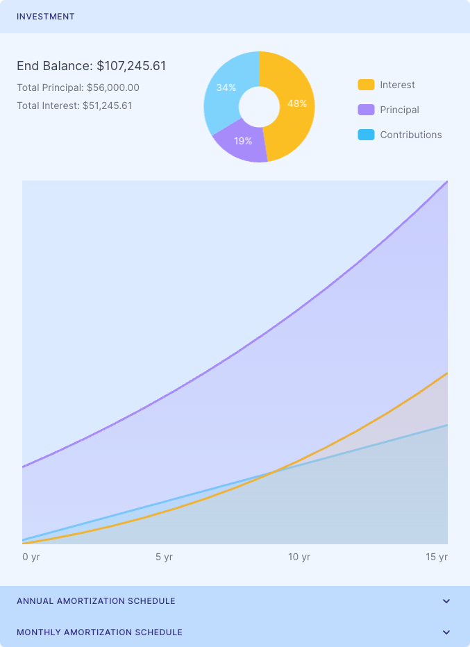

# Savings Calculator Widget for WordPress

This free savings calculator considers the initial and ending balances, return rate, and investment time when evaluating various investment circumstances.

## Installation

1. [Download](https://github.com/Malcolm-Hall/savings-calculator) the ZIP file of this repository.
2. [Install](https://wordpress.com/support/plugins/install-a-plugin/#install-a-plugin-with-a-zip-file) the plugin into WordPress.
3. Activate the [Savings Calculator](https://malcolm-hall.github.io/savings-calculator/ "Savings Calculator Homepage") plugin through the "Plugins" menu in WordPress.

## Usage

* Add the shortcode `[ci_savings_calculator]` to your page, post or sidebar.
* Or add the following code: `<?php display_ci_savings_calculator(); ?>` to your template where you would like the Savings Calculator to appear.

## Libraries in Use

1. [Chart.js](https://www.chartjs.org/)
