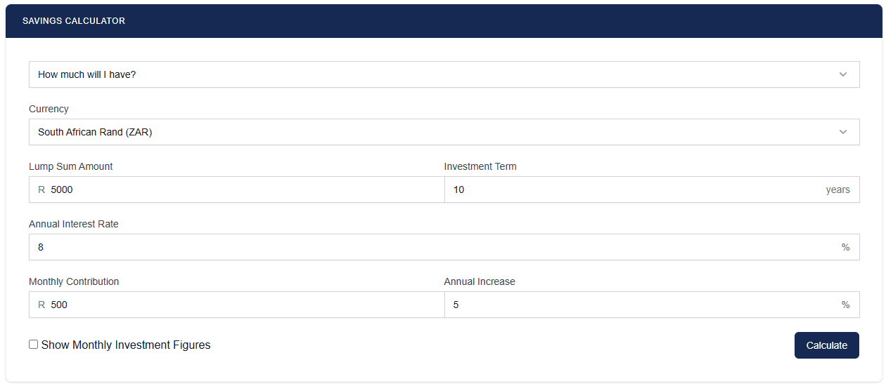
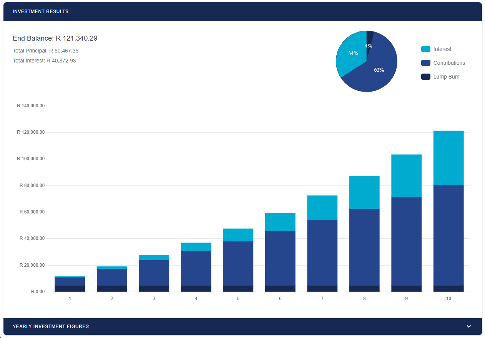

# Savings Calculator Widget for WordPress

This is a free savings calculator widget that can be embedded in wordpress sites.

View the live site at https://malcolm-hall.github.io/savings-calculator

## Installation

1. [Download](https://github.com/malcolm-hall/savings-calculator) the ZIP file of this repository.
2. [Install](https://wordpress.com/support/plugins/install-a-plugin/#install-a-plugin-with-a-zip-file) the plugin into WordPress.
3. Activate the [Savings Calculator](https://malcolm-hall.github.io/savings-calculator/ "Savings Calculator Homepage") plugin through the "Plugins" menu in WordPress.

## Usage

- Add the shortcode `[ac_savings_calculator]` to your page, post or sidebar

## Calculation Types

Add `?type=<value>` to the url to set the calculation type of the calculator
|value| calculation type|
|-|-|
| accumulation | How much will I have? |
| contribution | How much do I need to contribute to reach my savings goal? |
| interest-rate | What interest rate do I need to reach my savings goal? |
| lump-sum | How much would I need to invest initially to reach my savings goal? |
| investment-term | How long will I need to invest to reach my savings goal? |

## Libraries in Use

1. [Chart.js](https://www.chartjs.org/)
